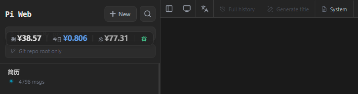
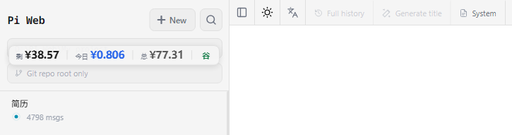
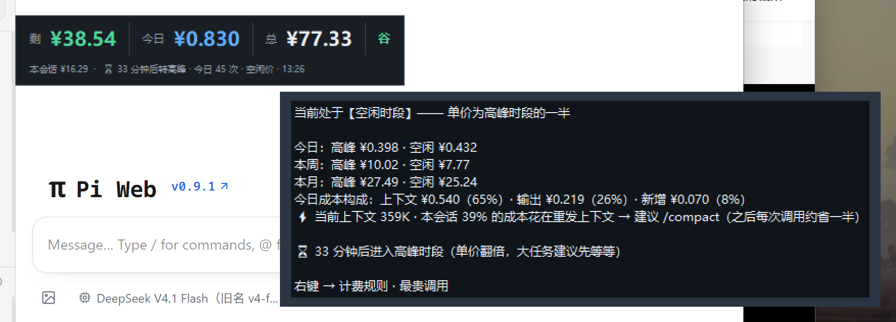
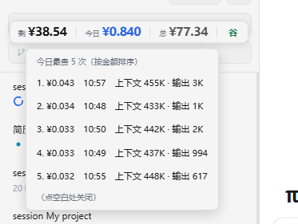

[README.md](https://github.com/user-attachments/files/32273929/README.md)

# DeepSeek 花费监控浮窗

**在 pi-web 里实时看到 DeepSeek 花了多少钱、还剩多少余额。**

一个嵌在 pi-web 页面左上角的迷你浮窗：三列数字 + 一个「峰 / 谷」计费时段标识，
配色自动跟随浅色 / 深色主题，可拖动、可锁定成页面原生元素、位置记忆。



零第三方依赖（纯 Python 标准库 + 原生 JS）· 零硬编码 · 纯本地运行（只监听 `127.0.0.1`）。

---

## 长什么样

| 深色主题 | 浅色主题 |
|---|---|
|  |  |

**鼠标悬停 → 明细**（今日 / 本周 / 本月峰谷拆分、今日成本构成、上下文健康建议、峰谷倒计时）：



**右键 → 菜单**（计费规则与单价 / 今日最贵调用）：



## 它能回答什么

| 显示 | 含义 |
|---|---|
| **剩** | 账户剩余余额（DeepSeek 官方接口，每分钟刷新）|
| **今日** | 今天花的钱（北京时间当天 00:00 起）|
| **总** | 累计花费（pi 所有会话记录合起来算）|
| **峰 / 谷** | 当前按高峰价还是空闲价计费 —— 谷 = 绿 = 便宜，峰 = 橙 = 贵 |
| 悬停 | 今日/本周/本月峰谷对比 · 今日成本构成 · 上下文健康建议 · 距下次峰谷切换的倒计时 |
| 右键 | 📋 计费规则与单价（三档单价 + 时段表）· 💸 今日最贵调用（Top 5，含上下文规模）|

## 三步装好

> 把仓库里的文件放到一个固定目录，然后：

```bash
python install.py doctor      # 逐项检查 python 版本 / pi-web 位置 / API Key / 会话目录
python install.py install     # 起数据服务 + 把浮窗注入 pi-web + 生成启动脚本
python install.py restart     # 重启 pi-web（让注入生效）
```

刷新浏览器页面即可看到浮窗。

> **为什么必须重启 pi-web**：它启动时会把首页 HTML 读进内存，注入的内容不重启看不到。
> 这一步**只需要做一次** —— 之后改浮窗代码只要重启数据服务 + F5（见下面「热加载」）。

**没装 pi-web 也能用**：`python ds_spend_widget.py` 起一个独立桌面悬浮窗，功能与网页版一致。

**给 AI agent 用**：`SKILL.md` 是写给 agent 读的完整说明（含每步的取舍原因与异常处理），
Claude Code / Cursor / pi 等可以直接把它放进 skills 目录。

## 余额与花费的差别（重要）

- **余额**是官方接口的真实值，覆盖你账户下**所有**消耗渠道（网页版、API、其他工具）
- **花费**是按 pi 会话日志里的 token 用量 × 官方峰谷单价**逐笔估算**的，只统计 pi 的调用
- 所以：两者对比可以看出"其他渠道花了多少"；数字与官方账单可能有极小差异

计价规则读自 `config.json`（单价、峰谷时段、星期全都可改），DeepSeek 调价或换模型时改配置即可，不用动代码。

## 设计上的几个取舍

| 取舍 | 原因 |
|---|---|
| **悬停只放"花了多少钱"**，不放规则 | 「距高峰期还有几小时」已经覆盖"什么时候贵"，首行"空闲只要一半"覆盖"贵多少"，再列完整单价表就是噪音。规则与明细都收进右键菜单，需要时一步可达 |
| **内联兜底 + 启动热加载** | 内联一份完整脚本（数据服务挂了浮窗也在，只显示 `—`）；页面加载后再向数据服务要最新版并原地替换。于是改代码只需重启数据服务 + F5，**不用重启 pi-web** |
| **锁定态用同色不透明背景**，而不是透明 | 第一版用全透明，结果和下层文字重叠；改成与面板同色的直角背景后才真正"融入页面" |
| **只读日志增量扫描** | 每 2 秒只读 `~/.pi/agent/sessions/**/*.jsonl` 新增的字节，几千次调用的历史也不卡 |

## 常见问题

| 问题 | 答案 |
|---|---|
| **一定要 API Key 吗？** | 不填也能用，但只能看花费、看不到余额。Key 在 DeepSeek 平台创建，也可设成环境变量 `DEEPSEEK_API_KEY` |
| **会花我的钱 / 上传数据吗？** | 不会。只调官方余额查询接口（免费）+ 读本地会话日志；无遥测，只监听 `127.0.0.1` |
| **浮窗挡住内容了** | 拖走，或右键「🔒 锁定位置（融入页面）」变成页面原生那种样式；双击可复位 |
| **显示 `¥ —`** | 数据服务没跑：`python install.py start` |
| **花费一直是 0** | `config.json` 里的 `sessions_glob` 没指对 pi 会话目录，`install.py doctor` 会提示 |
| **pi-web 升级后浮窗没了** | 注入被覆盖了，重跑 `python install.py install` + 重启 pi-web |
| **想彻底卸载** | `python install.py uninstall`，再 `python install.py stop` |

## 文件说明

| 文件 | 作用 |
|---|---|
| `assets/ds_monitor_server.py` | 数据服务：余额查询 + 会话用量增量扫描，提供 `/state`、`/widget.js` |
| `assets/pi-web-widget.js` | 注入到 pi-web 的浮窗组件（含悬停明细、右键菜单、热加载） |
| `assets/ds_spend_widget.py` | 独立桌面悬浮窗（tkinter，不用 pi-web 时的替代方案） |
| `assets/install.py` | 安装器：`doctor / install / status / start / stop / restart / uninstall` |
| `assets/config.json` | 端口、单价、峰谷时段、路径 —— 全部可改 |
| `SKILL.md` | 给 AI agent 的完整执行说明 |
| `shot-widget.py` | （开发用）重启桌面浮窗并自动截一张悬停提示的图 |

## 环境要求

- Python 3.8+（只用标准库；桌面版需要 tkinter）
- pi-web（网页版需要；不装则用桌面版）
- 已在 Windows 10/11 实测；Linux / macOS 理论上可用（`install.py` 里有非 Windows 分支）

## 关于这个项目

**这是第三方扩展，不是 pi-web 的官方功能。**

| 组件 | 作者 | 许可 |
|---|---|---|
| **[pi-web](https://github.com/agegr/pi-web)** —— 本浮窗注入并适配的 Web UI（`@agegr/pi-web`）| [@agegr](https://github.com/agegr) | MIT |
| **[pi](https://github.com/earendil-works/pi)** —— 会话日志（token 用量）的来源（`@earendil-works/pi-coding-agent`）| Mario Zechner / [@earendil-works](https://github.com/earendil-works) | MIT |
| **本 skill**（浮窗组件、数据服务、安装器）| [Keeplearning12345678](https://github.com/Keeplearning12345678) | MIT |

注入方式依赖 pi-web 的页面结构（只有 `/` 一个路由、首页 HTML 在 `.next/server/app/index.html`）。
pi-web 如果做了大的结构调整，注入可能失效 —— 重跑 `python install.py install` 即可；若仍失效，欢迎提 issue。

计价口径以 [DeepSeek 官方价格页](https://api-docs.deepseek.com/zh-cn/quick_start/pricing) 为准：
本项目只是把它的峰谷规则实现了一遍，单价与时段随时可在 `config.json` 里改，不用改代码。

## License

[MIT](LICENSE)
